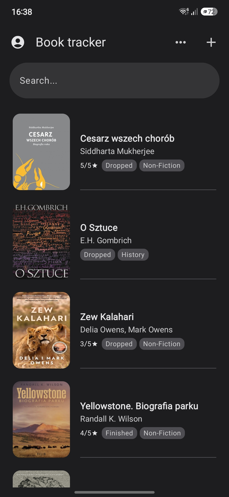
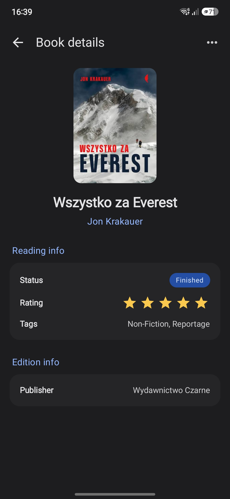
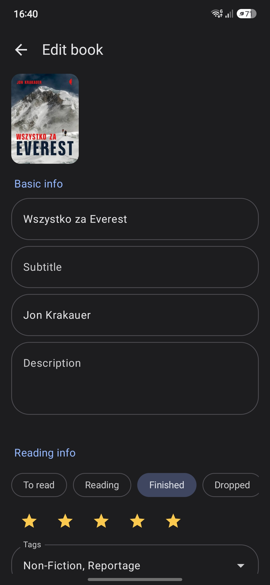

# Book tracker
An Android app for organizing your personal library. Track books by reading status, manage custom tags, discover books online or by scanning ISBN barcodes, and keep your collection organized.

## Screenshots
<p align="center">
  
  
  
</p>

## Features
- Track book across 4 statuses (to read, reading, finished, dropped).
- Custom tags.
- List/grid layout format.
- Barcode/ISBN scanner.
- Online Book & cover search.
- Scan book ISBN barcode.
- Import/export backups.
- Material3 design.
- Dark mode support.

## Tech stack
- Kotlin
- Jetpack Compose + Material 3
- MVVM
- Coroutines + StateFlow
- Hilt
- Retrofit
- Coil3
- Room + DataStore
- Firebase Remote Config
- CameraX + Google ML Kit barcode scanning

## Setup
The app contains dev and prod flavors.

1. git clone https://github.com/jkoffer/book_tracker.git
2. Create local.properties file in the root folder, add SDK location and SerpApi key:
```
sdk.dir=C\:\\Users\\YourUsername\\AppData\\Local\\Android\\Sdk
SERP_API_KEY=your_serp_api_key_here
```


